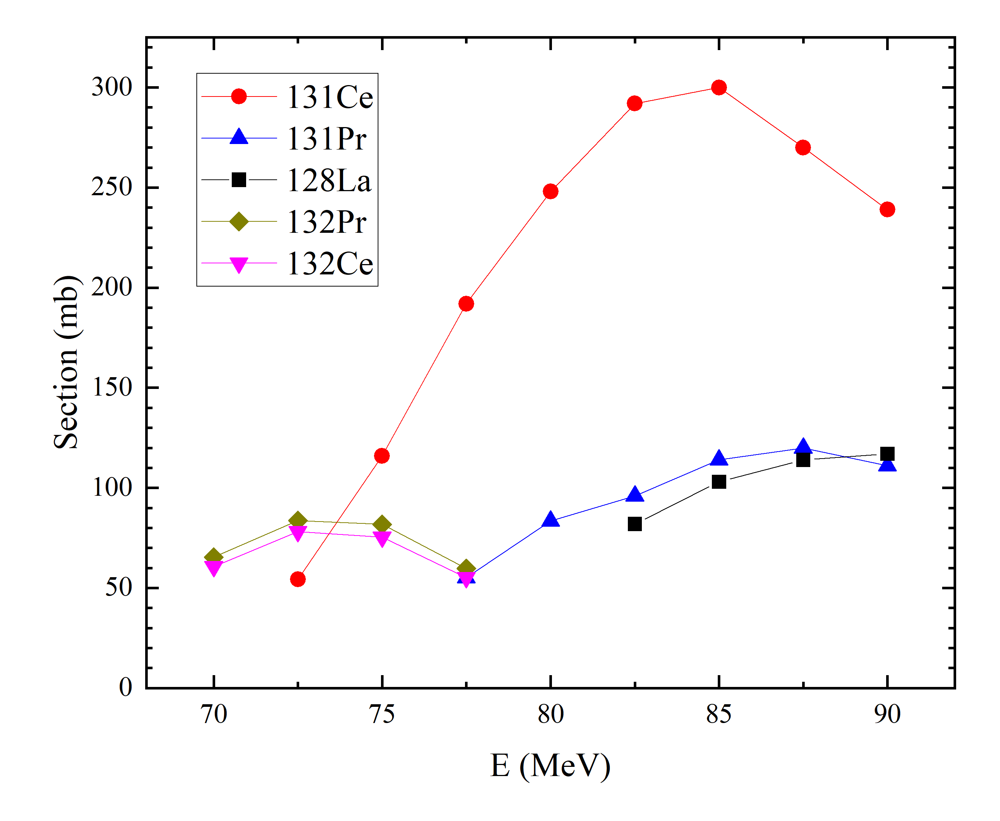
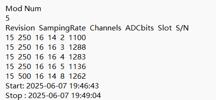
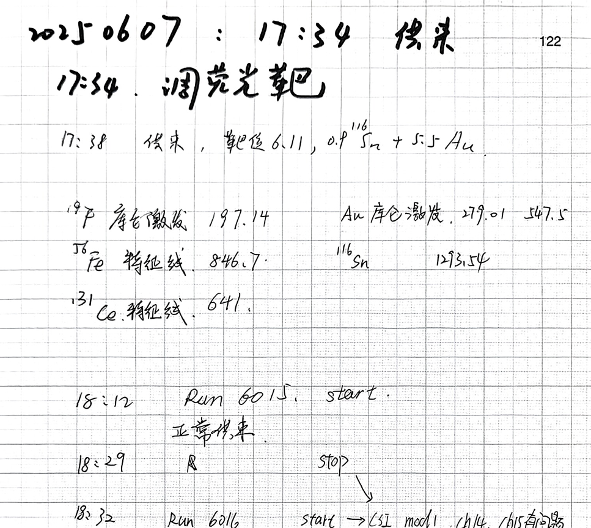
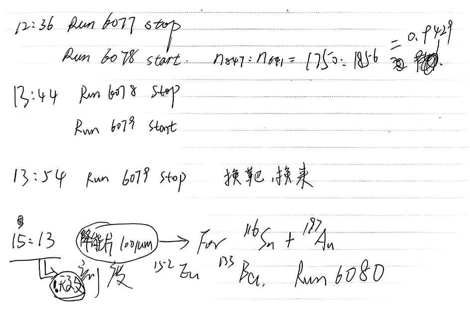
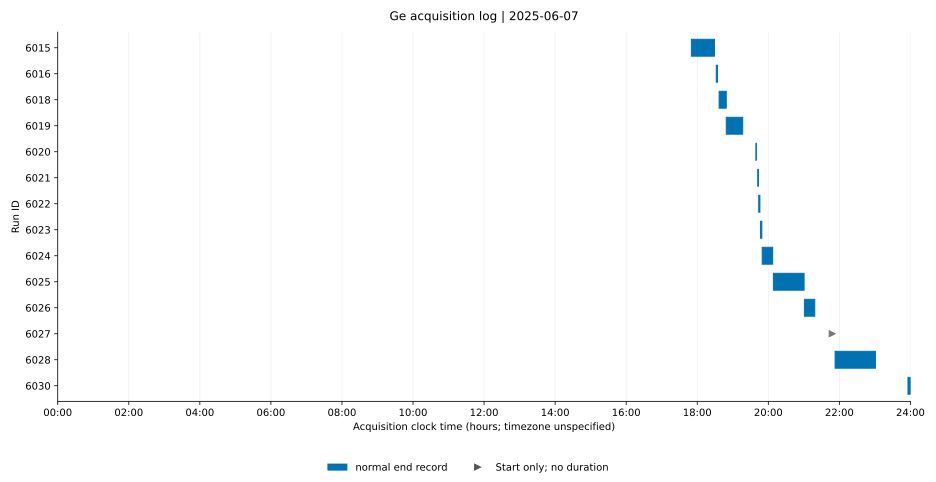
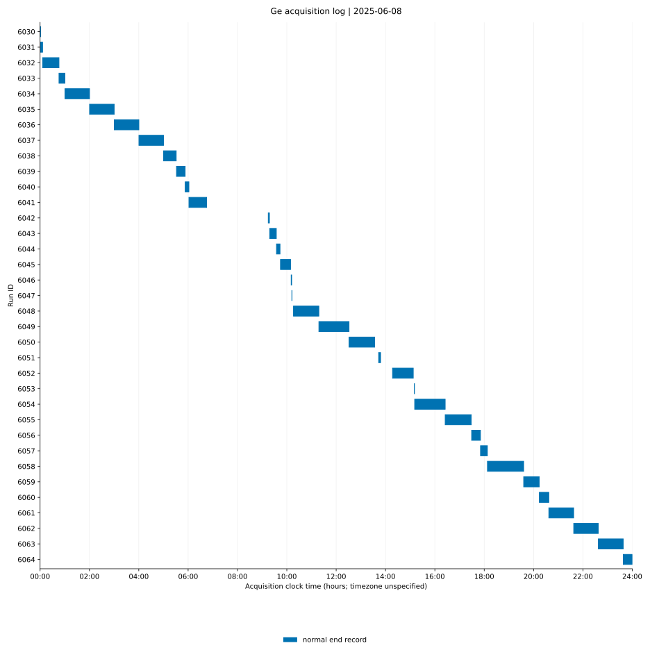
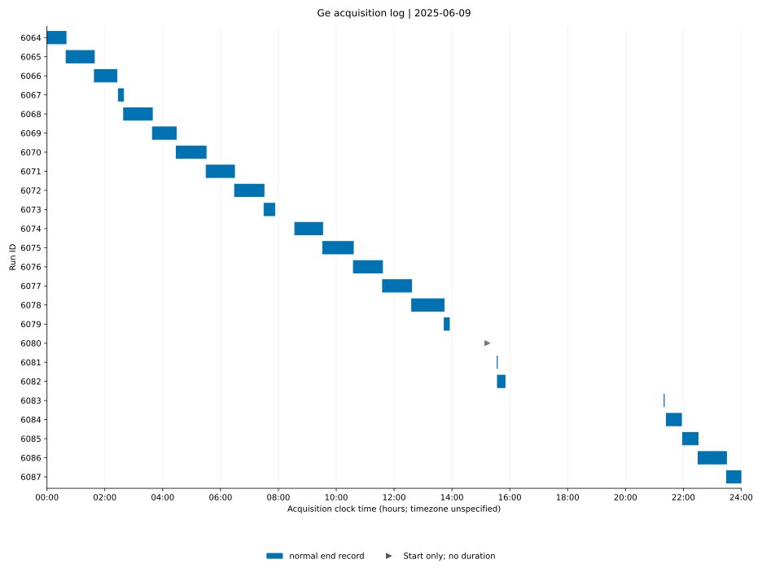

# work log: $^{131}$Ce

## 实验信息

### 反应道

1. 19F + 116Sn ：$0.9mg/cm^{2}\ ^{116}Sn + 5.5mg/cm^2 Au$ @ 85MeV 1p3n
   

### 实验设置

#### 探测器放置

##### Ge

1. Ge map

2. Ge 采集卡频率

##### CsI

1. CsI map

2. CsI 采集卡频率

### Important information

#### Duration

1. Start time: 20250607-1738-**run6015**

    

2. finish time: 20250609-1344-**run6079**

   

3. Run summary

   1. > 1. 2025-06-07: runs 6015–6030
      > 2. Invalid run: 6027
      > 3. Runs shorter than 3 min: 6016, 6020–6023

      

   2. > 1. 2025-06-08: runs 6031–6064
      > 2. Invalid run: None
      > 3. Runs shorter than 3 min: 6042, 6046, 6047, 6053

      

   3. > 1. 2025-06-09: runs 6065–6079
      > 2. Invalid run: None
      > 3. Runs shorter than 3 min: None

      

#### Important events

1.  *20260607-1832*. ==Unexpected events.==  ERROR  CsI(Ti): cid=1, mod=1, ch=14,15.
2.  *20260607-1916*. ==Unexpected events.==  ERROR CsI(Ti), specially for 
   1. cid=1, mod= 0, ch=10, 11, 12, 13, 14, 15.
   2. cid=1, mod=1, ch=12, 13, 14, 15.
   3. cid=1, mod=6, all channels.
3.  *20250607-1946*. Normal events: Filling LN to HPGe. 
4.  *20250607-1946*. ==Unexpected events==: CsI detectors were meeting problem in HV for RING 1& 6; cid=1, mod=1, ch=14, 15 detectors had problems in HV PIN.
5.  *20250607-2008*. ==Unexpected events==: cid=1, mod=3, ch=1,2,3.
6.  *20260607-2100*. Normal events: Filling LN to HPGe.
7.  *20260607-2153*. ==Unexpected events==: Removed cid=1, mod=1, ch=14, 15.
8.  *20260607-2345*. ==Unexpected events==: Data required system restarted; run 6029 was abnormally close and run 6030 and 6031 are debug files.
9.  *20260608-0016*. Normal events: cid=1, mod=8 inrata was opened.
10.  *20260608-0531*. ==Unexpected events==: The accelerator was malfunction;  run 6039 was a decay file.
11.  *20260608-0552*. ==Unexpected events==: The accelerator was malfunction;  run 6040 was a decay file.
12.  *20260608-0647*. ==Unexpected events==: The accelerator was malfunction;  Changing the detector to target position  (15# +3 cm, 36# & 39# +2 cm ) and adding a low-energy gamma-ray absorber(27#, 28#).
13.   *20260608-0647*. Normal events: Filling LN;
14.  *20260608-0915*.  Normal events: The accelerator was function and beam came.
15.  *20260608-0937*. ==Unexpected events==: adding a low energy gamma-ray absorber to cid=0, mod=0, ch=8.
16.  *20260608-1012*. ==Unexpected events==: changing cid=1, mod=8 because of lowing counts.
17.  
18.  ==Unexpected events.== (cid, mod, ch)=(1, 1, 14), (1, 1, 15), (1, 3, 1), (1, 3, 2), (1, 3, 4) had problems. Those are CsI. 
19.  
20.  ==Unexpected events.== charge module: 20250608-1419- Module 8 was changed to module 9 in crate_1 of CsI from **run6052**.

2. 
