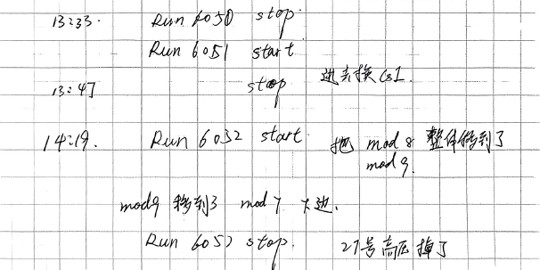

# work log

## 实验信息

### 反应道

1. 19F + 116Sn ：$0.9mg/cm^{2}\ ^{116}Sn + 5.5mg/cm^2 Au @ ？MeV$ 1p3n
   

### 实验设置

#### 探测器放置

##### Ge

1. Ge map

2. Ge 采集卡频率

##### CsI

1. CsI map

2. CsI 采集卡频率

### Important information

#### start -> finish

1. Start time: 202506071738-**run6015**

    

2. finish time: 202506091344-**run6079**

   

#### Unexpected events

1. charge module: 

